## 自己紹介

- Motoki KAMIMURA
- GitHub: [usabarashi](https://github.com/usabarashi)
- ~~🧑🏻‍💻: Lean, Quint, TLA+, Alloy, Scala, Rust, TS, HCL, Nix, etc~~
- 🧑🏻‍💻: AI Agent Pachinko
- 🍵: サーバーラック導入で Homelab がスッキリした

## 本発表の内容

- 🙅: AI サービスの話
- 🙅: AI アルゴリズムの話
- 🙆: 生活を整理整頓する話

<div style="text-align:center; font-weight:600; font-size:0.85em; margin-top:1.4em; line-height:1.6;">AI が適切に動く環境の整理整頓が要る</div>


## AI の歴史

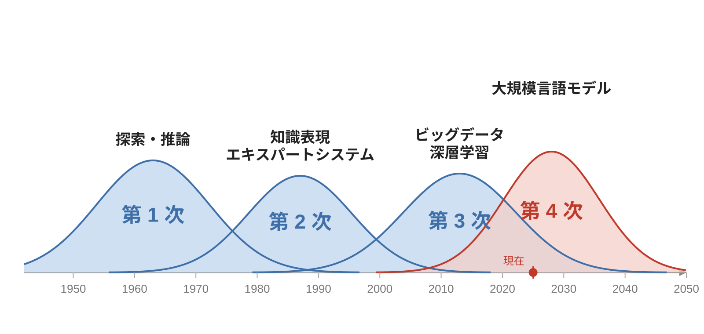{fig-alt="AI ブームの波と主な時代（第1次から第4次）の年表" fig-align="center" width="94%"}

<div style="text-align:center; font-weight:600;">
最近, 皆んなが言っている AI は大規模言語モデル
</div>


## LLM サービス利用遍歴

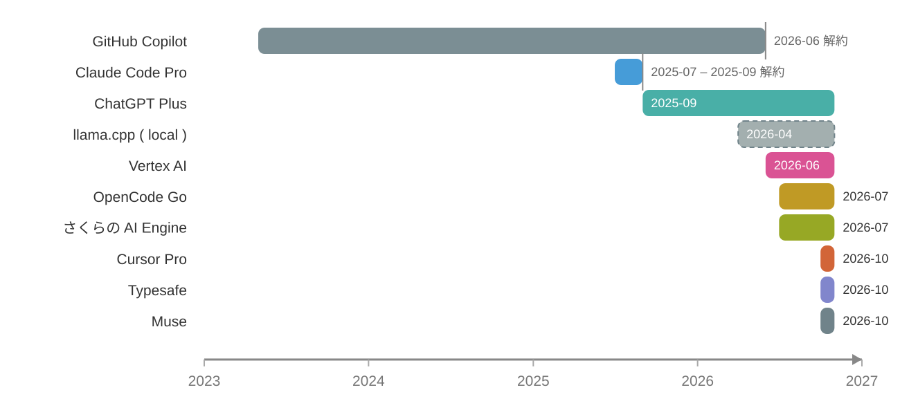{fig-alt="2025-07 の Claude Code Pro から 2026-10 の Cursor Pro / Typesafe までの利用期間. " fig-align="center" width="92%"}

<div style="text-align:center; margin-top:0.4em; font-size:0.78em; line-height:1.6; opacity:0.9;">仕事で触らないサービスを試す</div>


## 主に利用しているサービス

<div style="display:flex; gap:0.9rem; text-align:center; align-items:flex-start; margin-top:1.4em; font-size:0.84em;">

<div style="flex:1;">
<div style="height:2.6em; display:flex; align-items:center; justify-content:center;"></div>
<div style="font-weight:700; margin-top:0.2em; line-height:1.2; min-height:2.3em; display:flex; align-items:center; justify-content:center;">ChatGPT Plus</div><div style="font-size:0.85em; opacity:0.75; margin-top:0.35em;">Chat + Work</div>
<div style="font-size:0.72em; margin-top:0.6em;">料金体系の変更</div>
</div>

<div style="flex:1;">
<div style="height:2.6em; display:flex; align-items:center; justify-content:center;">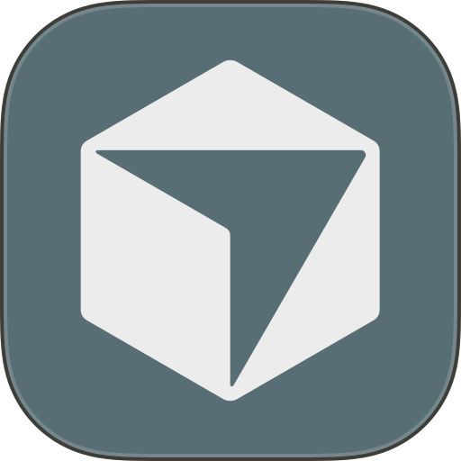</div>
<div style="font-weight:700; margin-top:0.2em; line-height:1.2; min-height:2.3em; display:flex; align-items:center; justify-content:center;">Cursor Pro</div><div style="font-size:0.85em; opacity:0.75; margin-top:0.35em;">X Subscription</div>
<div style="font-size:0.72em; margin-top:0.6em;">料金体系の変更</div>
</div>

<div style="flex:1;">
<div style="height:2.6em; display:flex; align-items:center; justify-content:center;"></div>
<div style="font-weight:700; margin-top:0.2em; line-height:1.2; min-height:2.3em; display:flex; align-items:center; justify-content:center;">OpenCode Go</div><div style="font-size:0.85em; opacity:0.75; margin-top:0.35em;">Global Regions</div>
<div style="font-size:0.72em; margin-top:0.6em;">個人情報の取り扱い</div>
</div>

<div style="flex:1;">
<div style="height:2.6em; display:flex; align-items:center; justify-content:center;"></div>
<div style="font-weight:700; margin-top:0.2em; line-height:1.2; min-height:2.3em; display:flex; align-items:center; justify-content:center;">さくらの<br>AI Engine</div><div style="font-size:0.85em; opacity:0.75; margin-top:0.35em;">Japan Region</div>
<div style="font-size:0.72em; margin-top:0.6em; white-space:nowrap;"><s>デジタル赤字</s></div>
</div>

</div>

<div style="text-align:center; margin-top:0.9em; line-height:1.5; font-size:0.85em;">
<div style="font-weight:600;">無邪気に学べる期間は終わった</div>
<div style="opacity:0.85;">個人のお財布の範囲で</div>
</div>


## AI Google Account を用意する

::: {style="font-size:0.85em"}
- Google Account はキメ細かい権限設定ができない
- AI Google Account を 1 つ用意する
- AI Google Account へ, 参照してよいメールだけ転送する
- AI Google Account へ, 参照してよいファイルだけ共有する
:::

<div style="margin-top:1em; font-size:0.72em;">
<span style="color:#dc322f; font-weight:700;">転送やフィルタの設定は gmailctl で宣言的に管理する</span>
</div>


## &nbsp;

<div style="display:flex; align-items:center; justify-content:center; height:70vh;">
<div style="font-size:1.9em; font-weight:700; text-align:center;">プライベートに AI を組み込む</div>
</div>


## AI を組み込んだシステムの重要要素

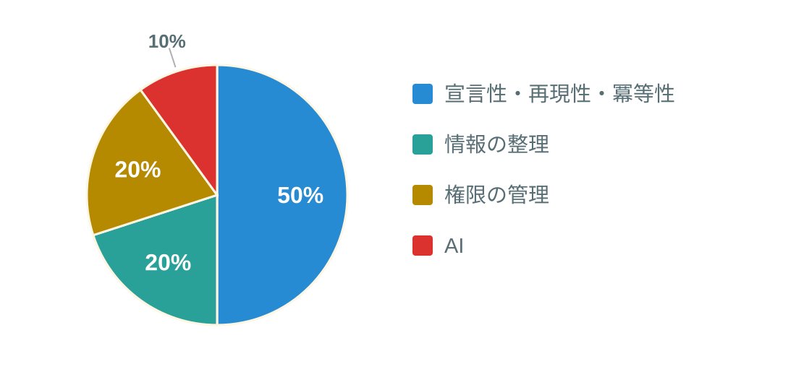{fig-alt="重要要素の割合: 宣言性・再現性・冪等性 50%, 情報の整理 20%, 権限の管理 20%, AI 10%" fig-align="center" width="82%"}

<div style="text-align:center; font-weight:600; font-size:0.85em; white-space:nowrap;">
認知・判断・管理・運用のコストを減らす
</div>

<div style="text-align:center; font-size:0.55em; opacity:0.65; margin-top:0.4em;">
※ 個人のスタイル
</div>


## &nbsp;

<div style="display:flex; align-items:center; justify-content:center; min-height:38vh;">
<div style="font-size:1.9em; font-weight:700; text-align:center;">宣言性・再現性・冪等性</div>
</div>

<div style="text-align:center; font-size:0.85em; line-height:1.7;">
<div>AI が状態を正しく判断できる</div>
<div>AI が何を操作したか, 人間が正しく判断できる</div>
</div>


## Infrastructure as Code

```{code-line-numbers="false" style="font-size:0.72em"}
infrastructure/
├── nix/        # ホストの構成・配備（hosts / modules / pkgs）
├── terraform/  # Cloud・SaaS の設定（プロバイダごと）
│   └── <provider>/
├── mail/       # メールフィルタ
└── apps/       # 小さな自動化
```

- 手で設定せず, コードで書く
- 宣言性: 手順ではなく「あるべき状態」を書く
- 再現性: 同じコードから, 同じ環境が何度でも作れる
- 冪等性: 何度実行しても, 結果が変わらない
- 管理対象の状態が分かる


## Application Nix module を IaC に統合する

<div style="text-align:center;">
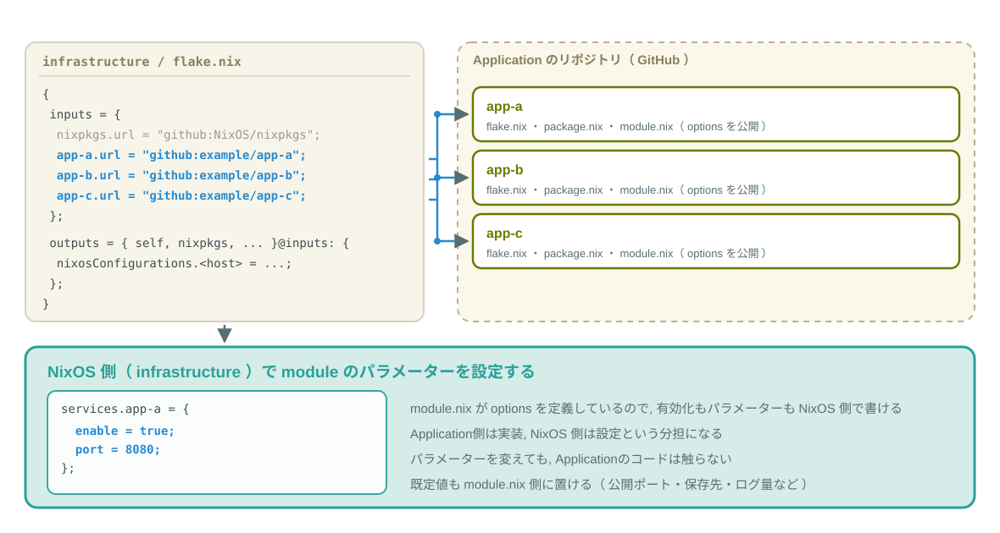
</div>

<div style="text-align:center; margin-top:8px; font-size:0.78em;">Application の更新は flake.lock の更新として扱える</div>


## Client 環境を Nix で宣言的に管理する

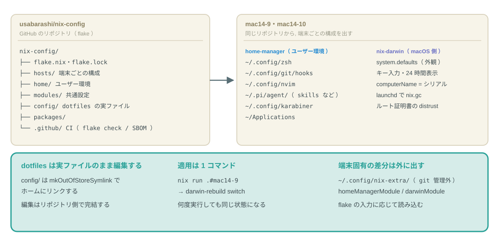{fig-alt="usabarashi/nix-config リポジトリ（ flake.nix / hosts / home / modules / config / packages ）から home-manager と nix-darwin で各端末の ~/.config と macOS 設定を配置する構成図. 下部に dotfiles の編集・適用コマンド・端末固有の差分の扱いを示す" fig-align="center" width="96%"}

<div style="text-align:center; margin-top:0.4em; font-size:0.72em;">パッケージ・dotfiles・macOS の設定を 1 リポジトリで管理する</div>


## 異常検知の構成

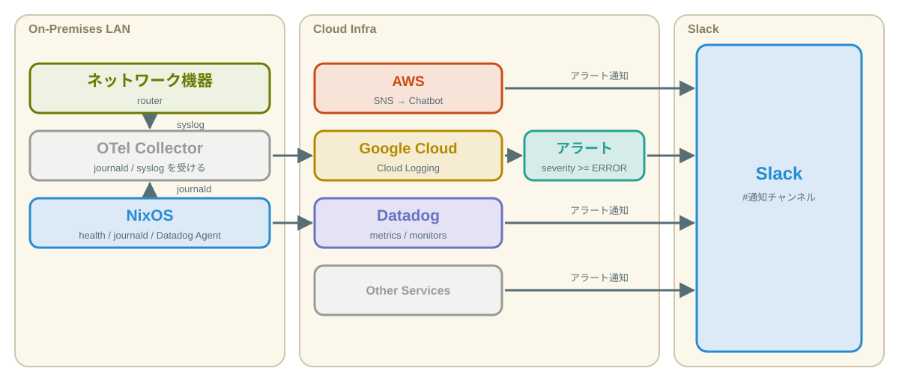{fig-alt="On-Premises LAN（NixOS・ネットワーク機器・OTel Collector）から Google Cloud へログを送り, severity>=ERROR のアラート, Datadog のアラート, AWS のアラートが Slack に届く構成図" fig-align="center" width="88%"}

<div style="text-align:center; margin-top:1em; font-size:0.78em; line-height:1.5;">
<div>ログは Cloud Infra の可用性を活用する</div>
</div>


## AI Agent による調査・修正の構成

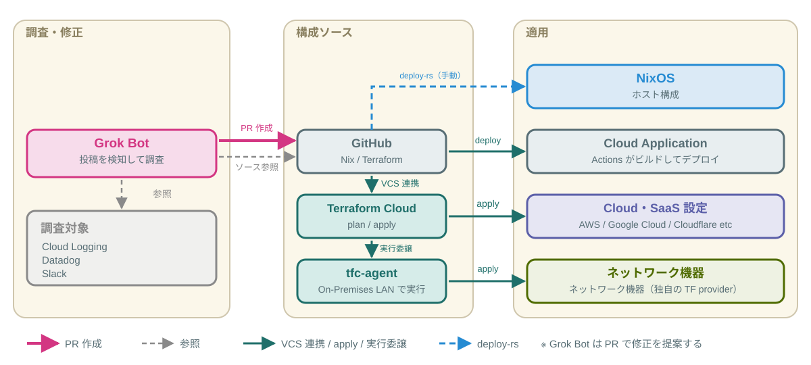{fig-alt="調査・修正（Grok Bot）／構成ソース（GitHub・Terraform Cloud・tfc-agent）／適用（NixOS・Cloud Application・Cloud・SaaS 設定・ネットワーク機器）の 3 列の構成図. PR 作成・参照・VCS 連携・apply・実行委譲・deploy を線種で区別している" fig-align="center" width="92%"}

<div style="text-align:center; margin-top:0.5em; font-size:0.66em; line-height:1.45;">
<div style="font-weight:600;">参照元と更新結果が実態を表す</div>
<div style="opacity:0.85;">人が Review して Merge → TFC が自動 apply / NixOS は deploy-rs で手動</div>
</div>


## 情報と実態の乖離を常に是正する

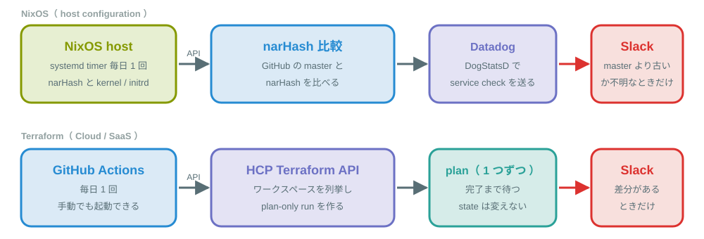{fig-alt="NixOS ホストの systemd timer が毎日デプロイ済み flake の narHash と booted / current の kernel と initrd を確認し, narHash を GitHub の master と比べて Datadog へ送り, master より古いか不明なときだけ Slack に通知する上段と, GitHub Actions が毎日 HCP Terraform API を呼び, 全ワークスペースに plan-only run を実行して差分があるときだけ Slack に通知する下段の図" fig-align="center" width="90%"}

<div style="margin-top:0.2em; font-size:0.85em;">
<ul>
<li>情報の正しさを常に担保する</li>
<li>NixOS: 毎日 narHash を GitHub と比べ, kernel / initrd のずれも見る</li>
<li>Terraform: 毎日 plan を回し, drift を見る</li>
<li>通知条件を満たしたときだけ Slack に流す</li>
</ul>
</div>


## 独自 Provider で On-Premises 機器を管理

<div style="margin-bottom:-1.6em;">
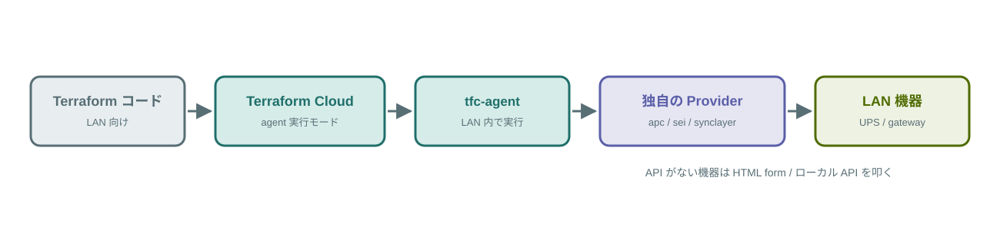{fig-alt="Terraform コード → Terraform Cloud（agent 実行）→ tfc-agent（On-Premises LAN）→ 独自の Provider → On-Premises 機器（UPS / gateway）の流れ" fig-align="center" width="100%"}
</div>

::: {style="font-size:0.85em"}
- API がない機器は, 独自の provider で宣言的に管理する
- 通信が HTML form, REST, Bluetooth, Infrared でも, Terraform の provider プロトコルに抽象化する
- <span style="color:#dc322f; font-weight:700;">宣言性・再現性・冪等性を確保する環境を, AI を使って作る</span>
:::


## &nbsp;

<div style="display:flex; align-items:center; justify-content:center; min-height:38vh;">
<div style="font-size:1.9em; font-weight:700; text-align:center;">情報の整理</div>
</div>

<div style="text-align:center; font-size:0.85em; line-height:1.7;">
<div>構造で把握する</div>
<div>ゴミ漁りにコストを払わない</div>
</div>


## Architecture

::: {style="font-size:0.88em"}

- AI の生成物が増えると, 人間は詳細を追いきれなくなる
- 構造と動線を拠り所にして妥当性を判断する
- 片付いた家は, 置き場所が決まっている
- デジタルに質量はないが, 整理されていなければ実態はゴミ屋敷
- 情報が分類されていると, 捨てる判断ができる
- 歪さは構造から読み取る
- アーキテクチャなど専門用語があるが, 要は<span style="color:#dc322f; font-weight:700;">整理整頓</span>
:::


## &nbsp;

<div style="display:flex; align-items:center; justify-content:center; height:72vh;">
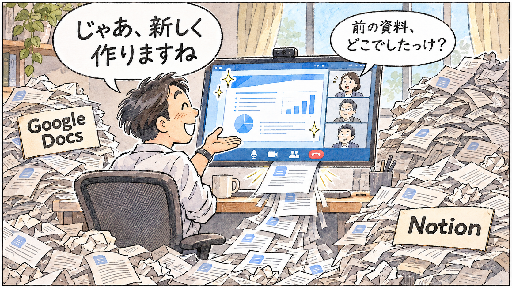
</div>

## &nbsp;

<div style="display:flex; align-items:center; justify-content:center; height:72vh;">

</div>

## &nbsp;

<div style="display:flex; align-items:center; justify-content:center; height:72vh;">
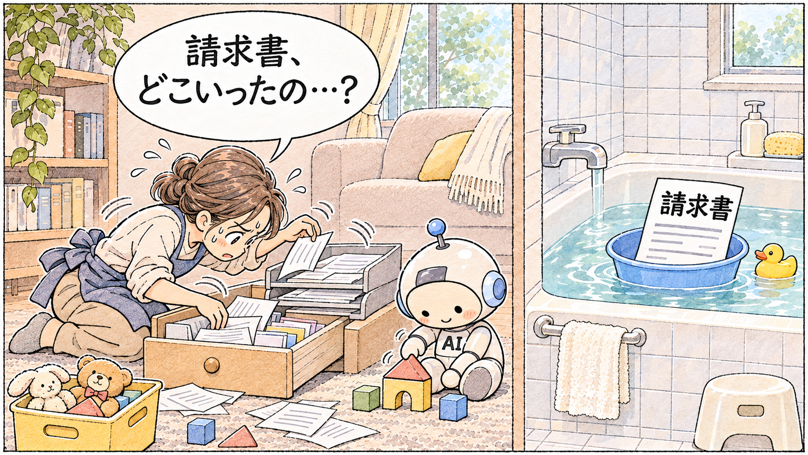
</div>

## モデルは記憶しない

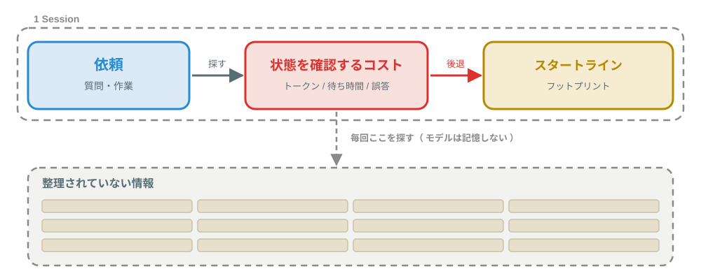{fig-alt="依頼 → 状態を確認するコスト → スタートライン の流れ. コストの箱から, 整理されていない情報を毎回探すことを破線で示している" fig-align="center" width="94%"}

<div style="text-align:center; margin-top:0.4em; font-size:0.74em; line-height:1.5;">
<div style="font-weight:600;">使い続けるほどにフットプリントが膨張する</div>
<div style="opacity:0.85; font-size:0.92em;">整理されていない情報の<span style="color:#dc322f; font-weight:700;">ゴミ漁り</span>を, 毎回トークンと待ち時間で払う</div>
</div>


## &nbsp;

<div style="display:flex; align-items:center; justify-content:center; min-height:38vh;">
<div style="font-size:1.9em; font-weight:700; text-align:center;">権限の管理</div>
</div>

<div style="text-align:center; font-size:0.85em; line-height:1.7;">
<div>人間が把握していないゴミを作らせない</div>
<div>生活をゴミ屋敷にさせない</div>
</div>


## Harness / Software Factory

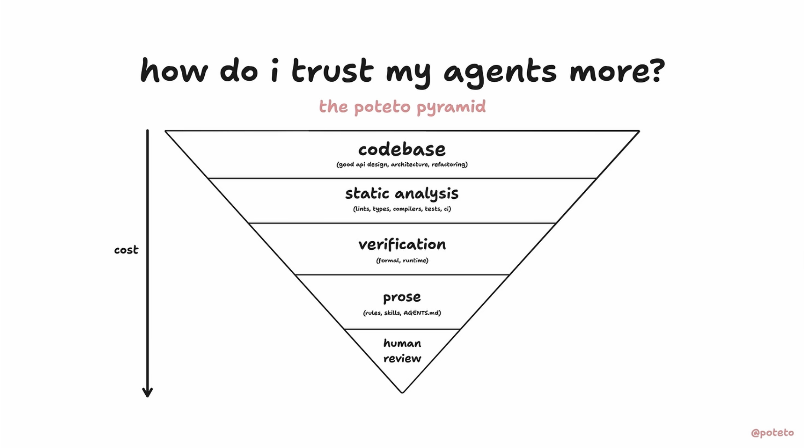

<div style="text-align:center; margin-top:0.5em; font-size:0.6em; line-height:1.6; opacity:0.8;">
<div>出典: All Code Is Slop (Except Mine) — Lauren Tan, SpaceXSI（ YouTube ）</div>
<div><a href="https://www.youtube.com/watch?v=O_zcc6Xl12g">https://www.youtube.com/watch?v=O_zcc6Xl12g</a></div>
</div>


## Harness / Software Factory（要点）

::: {style="font-size:0.82em"}
まずはコードベースの改善 (Linterによる防止, アンチパターンの排除) と強力な検証の仕組みを整えること.
自身のコーディング環境が Slop を生み出している状態で自動化を進めれば Slop が増えるだけである.

- Agent が正しく動作すると確信できるように Agent の環境に投資する
- ループが Slop を生むなら, 自動化しても Slop が増えるだけ
  - AI は正しくないことを正当化するコメントを書き残す
  - 悪い見本を放置すると AI が模倣し, 瞬く間に全体が Slop 化する
- Agent の行動を制限しデフォルトで正しいことを行うように強制する
  - 強制力のないコメントではなく決定論的なチェックに注力する
  - 型システム, Linter, 依存グラフの制限, API設計, 実行時検証 (Chrome DevTools), 形式検証 (TLA+, Lean) を活用する
:::


## Client Agent 構成

<div style="display:flex; justify-content:center;">
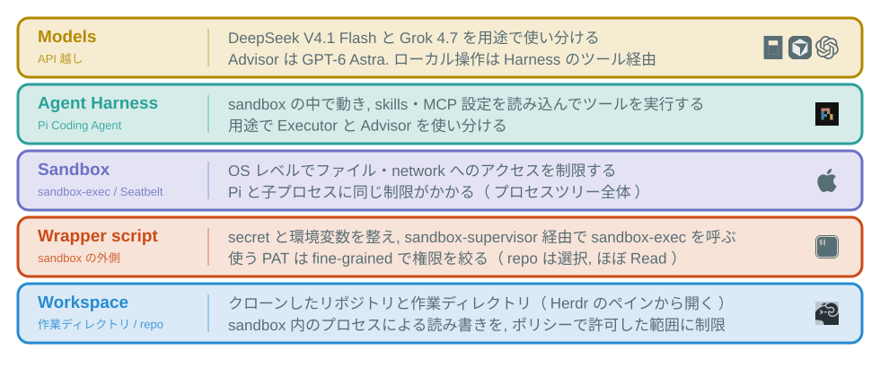
</div>

<div style="text-align:center; margin-top:0.1em; font-size:0.66em; line-height:1.32;">
<div style="opacity:0.85; font-size:0.92em;">Client Agent 構成を Nix で宣言的に管理する</div>
<div style="font-weight:700; color:#dc322f; font-size:0.92em;">理想は, Client 環境ではなく Remote sandbox 環境で動かす</div>
</div>


## On-Premises Remote Agent 構成

<div style="display:flex; justify-content:center;">
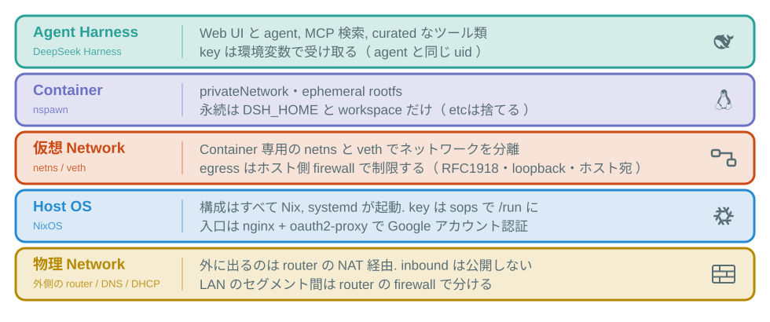
</div>

<div style="text-align:center; margin-top:0em; font-size:0.66em; line-height:1.32;">
<div style="opacity:0.85; font-size:0.92em;">Remote Agent 構成を Nix で管理する</div>
<div style="font-weight:700; color:#dc322f; font-size:0.92em;">理想は, On-Pemisses LAN から切り離した Cloud sandbox 環境で動かす</div>
<div style="font-weight:700; color:#dc322f; font-size:0.92em;">完全に個人情報から隔離できれば Free Model を試用できる</div>
</div>


## Security Review の構成

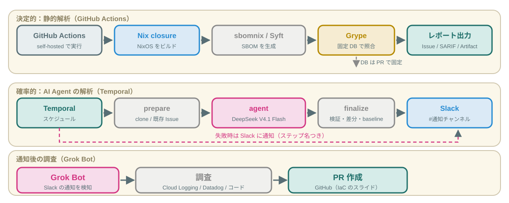{fig-alt="決定的な静的解析（GitHub Actions → Nix closure → sbomnix/Syft → Grype → レポート出力）と, AI Agent の確率的な解析（Temporal → prepare → agent → finalize → Slack → Grok Bot）を組み合わせた構成図" fig-align="center" width="100%"}

<div style="text-align:center; margin-top:0.5em; font-size:0.74em; line-height:1.5;">
<div style="font-weight:600;">決定的な静的解析と, AI Agent の確率的な解析の組み合わせ</div>
<div style="opacity:0.85; font-size:0.9em;">静的な側は再現でき, AI 側だけモデルとプロンプトに依存する</div>
<div style="opacity:0.85; font-size:0.9em;">AI Agent には必要最低限の権限のみ個別に与える</div>
</div>


## &nbsp;

<div style="display:flex; align-items:center; justify-content:center; min-height:38vh;">
<div style="font-size:1.9em; font-weight:700; text-align:center;">AI</div>
</div>

<div style="text-align:center; font-size:0.85em; line-height:1.7;">
<div>システムのコントロールブレインにしない</div>
<div>電気・ガス・水道と同じ位置づけにする</div>
<div>差し替えられる位置づけにする</div>
</div>


## AI 組み込みは Outcome ではない

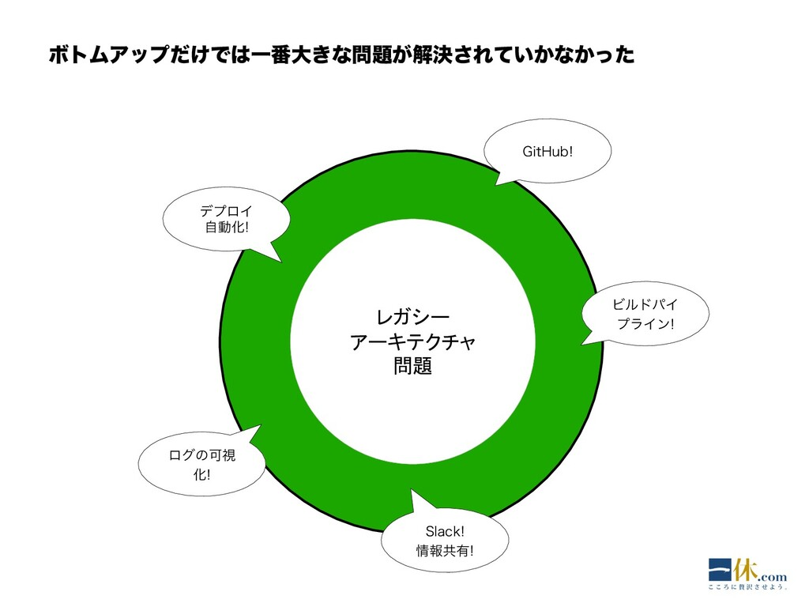

<div style="text-align:center; margin-top:0.6em; font-size:0.5em; line-height:1.6; opacity:0.75;">
<div>出典: Naoya Ito「問題から目を背けず取り組む — 一休の開発チームが 6 年間で学んだこと」 Speaker Deck, slide 30</div>
<div><a href="https://speakerdeck.com/naoya/wen-ti-karamu-wobei-kezuqu-rizu-mu-xiu-falsekai-fa-timuga6nian-jian-dexue-ndakoto?slide=30">speakerdeck.com/naoya/…?slide=30</a></div>
</div>

<div style="text-align:center; margin-top:0.7em; line-height:1.5;">
<div style="font-weight:600; color:#dc322f; font-size:0.62em;">既存システムを修正しない足し算は, 臭いものに蓋をするマトリョーシカにしかならない</div>
<div style="font-weight:600; color:#dc322f; font-size:0.62em;">安全圏の足し算は水遊びでしかない</div>
</div>


## Workflow

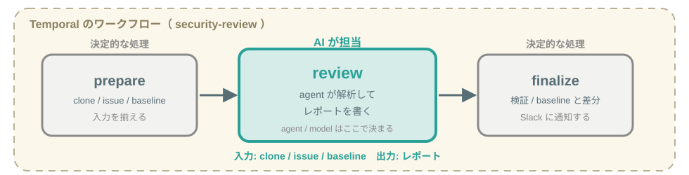{fig-alt="prepare → review → finalize の 3 step. AI が担当するのは review の 1 step だけで, 入力と出力が決まっているため差し替えられる" fig-align="center" width="92%"}

::: {style="font-size:0.78em"}
- ワークフロー全体を Prompt の泥団子で構成しない
- ワークフローを分解して一部の関数を AI で処理する
- 独立した関数を独立して改善してイテレーションを回す
- 個々の関数の複雑さにあわせてコスト最適化する
:::


## Personal AI Agent

<div style="display:flex; gap:1.2rem; text-align:center; align-items:flex-start; margin-top:0.6em;">

<div style="flex:1;">
<div style="height:2.2em; display:flex; align-items:center; justify-content:center;"></div>
<div style="font-weight:700; margin-top:0.15em;">dots</div>
<div style="font-size:0.72em; opacity:0.6; margin-top:0.1em;">OpenAI</div>
</div>

<div style="flex:1;">
<div style="height:2.2em; display:flex; align-items:center; justify-content:center;"></div>
<div style="font-weight:700; margin-top:0.15em;">Grok Bot</div>
<div style="font-size:0.72em; opacity:0.6; margin-top:0.1em;">X</div>
</div>

<div style="flex:1;">
<div style="height:2.2em; display:flex; align-items:center; justify-content:center;"></div>
<div style="font-weight:700; margin-top:0.15em;">Muse</div>
<div style="font-size:0.72em; opacity:0.6; margin-top:0.1em;">Meta</div>
</div>

</div>

::: {style="font-size:0.76em"}
- 新しいパラダイムを体験するために積極的に触ってみると良い
- ブラックボックスで, 移行が保証されず, 継続性がない
- インフラとして, 認知・判断・管理・運用のコストで判断する
- <div style="color:#dc322f; font-weight:600;">安全圏の水遊びと位置づけ, 全てを切り捨てる事を想定して採用する</div>
- OpenClaw, Hermes Agent の導入を検討する
:::

## Local LLM

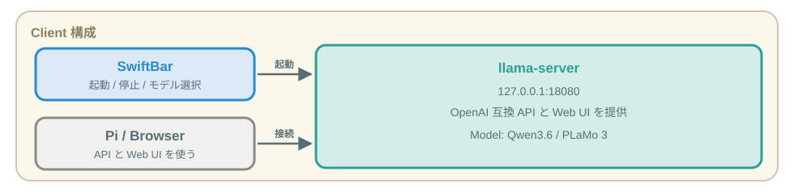{fig-alt="Client 構成の 2 経路: SwiftBar（ switch-to.sh 経由 ）が llama-server を起動する経路と, Pi / Browserが 127.0.0.1:18080 の OpenAI 互換 API と Web UI を使う経路. llama-server が両方の接続先になる" fig-align="center" width="92%"}

::: {style="font-size:0.76em"}
- 非常用バッテリーや非常食などと同じ位置づけ
- 常駐させず, 使うときだけ起動する
- 高性能 GPU を購入・運用しても個人利用では採算が取れない
- 平時は Cloud-hosted LLM を使用するのがコストが安い
:::


## まとめ

- 生活インフラの運用コストと代替手段を整理整頓する
- 1ヶ月後にはぜんぜん違うこと言ってるかも知らんけど

- [nix-config](https://github.com/usabarashi/nix-config)
- [usabarashi blog](https://usabarashi.github.io/blog/)
- [note](https://note.com/motoki_kamimura)


## お財布に余裕がある方はご自由に


<div style="text-align:center; margin-top:0.5em; font-size:0.5em; line-height:1.6; opacity:0.75;">
<div>出典: @YuYoshimuta の X 投稿</div>
<div><a href="https://x.com/YuYoshimuta/status/2119340884319945053">x.com/YuYoshimuta/status/2119340884319945053</a></div>
</div>
